# Architecture checks

The versioned model in `.architecture/model.json` owns package boundaries and contract ownership.
The checker compiles its rules in memory. It creates no generated files.
The checker is development tooling. The Gremlins binary does not import it.
ADR 0004 records the decision and its limits.

## Components and data flow

```mermaid
flowchart LR
  author[Developer] -->|proposed package relationships| design[Design JSON]
  tree[(Checkout: Go source)] -->|imports from every platform| parser[Go parser]
  model[(Architecture model)] -->|validated rules| compile[Rule compiler]
  compile -->|same compiled rules| evaluate[Evaluator]
  parser -->|source facts| evaluate
  design -->|proposed facts| evaluate
  target[(Pinned Git target)] -->|previous baseline| ratchet[Baseline comparison]
  current[(Candidate baseline)] -->|finding identities| ratchet
  evaluate -->|findings and repair instructions| ratchet
  ratchet -->|pass or failure| logs[Local or CI logs]
```

All stores reside in the checkout or its Git history. No data leaves this boundary except existing CI logs.
CI runs candidate code without secrets and with read-only repository permission.
The separate Sonar job retains its current token boundary.

## Rules

Every Go package needs an exact model entry. New packages fail closed until a maintainer reviews their ownership.
Production imports use explicit allowed internal dependencies. Tests can add separate dependencies and import their own package.
Design changes use `imports` for production and `test_imports` for tests. Both use the same rules as source scanning.
The scan includes generated Go files, platform files, custom build tags, and tests.
It excludes `.git`, `vendor`, `testdata`, and build output under `dist`.
These exclusions are fixed checker policy and require code review to change.
A nested module outside those exclusions is an error; classify or relocate it before proceeding.
Go's compiler retains responsibility for symbol resolution, package cycles, and `internal` visibility.
The checker evaluates import paths, including aliases, without resolving symbols.
Existing lint owns syntax, formatting, security analysis, and code style.

The model also names the canonical CLI, configuration, report, and exit-code contract paths.
CLI ownership includes mutation-command flags, persistent flags, and shared flag binding.
Each path must remain a regular file inside the checkout.
This checks ownership locations. It does not duplicate their contents or prove compatibility.
The model also owns canonical workflow, hook, lint, and design-step paths.
CI requires explicit design review for changes to those policies.
A design declares affected contracts and trust-boundary changes for explicit review.
The model lists allowed contract-change kinds and development-check trust boundaries.
Every affected contract needs a proposed change kind, such as `compatible`.
Every design declares destinations, network use, and source execution for each modeled trust boundary.
The evaluator rejects prohibited change kinds, destinations, network use, source execution, and unresolved conflicts.
Review evaluates prose assertions; the checker does not interpret prose as policy.

## Findings and baseline

Each rule has a stable ID, explanation, and repair instruction.
A finding identity contains its rule ID, relative file, and import path or other semantic subject.
Line numbers do not form identity. Repeated identical imports fail parsing or compilation; they cannot buy baseline capacity.
Diagnostics quote data fields to escape control characters.
Analysis failures and malformed inputs fail the command. They cannot enter the baseline.

The initial baseline is empty. The observed repository has no intended-boundary exception that needs suppression.
The checker never creates or enlarges a baseline.
Current findings must equal the candidate baseline identities. Remove stale entries when fixing a violation.
The candidate baseline must be a subset of the baseline at the comparison commit.
Equal-count replacements fail. Repeated baseline identities fail.
A missing baseline at first adoption means an empty baseline. Missing Git history is an error.
CI pins the PR base commit or the preceding push commit. Manual runs compare with `origin/dev`.
An initial branch push with no preceding commit compares with an empty baseline.

## Design before coding

1. Read the model and the affected contract sources.
2. Update `.architecture/design.json` with the planned packages, imports, contracts, trust boundaries, and rationale.
3. Run `make architecture-design` before editing implementation files. This executes `scripts/check-design.sh`.
4. Record the model digest and rule results in the issue plan.
5. Resolve every conflict before coding. Update the model only through a reviewed architecture decision.
6. Repeat the check when the design or model changes.

CI requires an updated design for package, contract, and policy changes.
It verifies coverage of each changed package, canonical contract, and policy.
CI checks declared relationships with the same compiler used by the source scan.
CI cannot prove when a developer ran a command. The issue plan records the pre-code evidence.
A new checker cannot execute before it exists. For #76, review the initial model and design manually before implementation.
Then execute that same design as the bootstrap verification. Future changes use the executable pre-code command.

## Security and failure behavior

| Threat and boundary | Control | Verification |
| --- | --- | --- |
| Unknown or malformed policy at JSON boundary | Strict decoder rejects unknown fields, duplicate keys, invalid versions, and invalid references. | Invalid-input tests. |
| Checkout escape at filesystem boundary | Reject linked policy files, traversal, and absolute model paths. Reject escaping links and linked Go input. Keep documentation links within the checkout. | Linked-file and path tests. |
| Executing input at analysis boundary | Parse imports only. No generators, tests, or model commands execute. | Parser fixtures with build tags and aliases. |
| Baseline laundering at Git boundary | Resolve a commit, read its baseline with fixed Git arguments, and compare identity sets. | Growth, replacement, stale-entry, and unavailable-history tests. |
| Hidden check failure at CI boundary | Architecture job runs for every event. PR Gate requires success. | Review workflow dependencies and run hosted checks. |
| Misleading diagnostics at log boundary | Quote input-derived fields. Do not print source or subprocess output. | Escaped-output tests. |

The checker reads explicit inputs. It does not load Gremlins configuration or environment overrides.
Logger initialization does not call configuration initialization.
Maintainer review remains necessary because a PR can change its own model, checker, and workflow.
No baseline rule protects against an arbitrary rewrite of those controls.

## References and design review

- [Go parser](https://pkg.go.dev/go/parser), Go 1.26.10 local standard-library source, `ParseFile` and `ImportsOnly`: import facts without execution.
- [Go JSON](https://pkg.go.dev/encoding/json), Go 1.26.10 local source, `Decoder.DisallowUnknownFields`: strict policy decoding.
- [C4 component diagrams](https://c4model.com/diagrams/component), Component diagram: component responsibilities and named relationships.
- [GitHub workflow events](https://docs.github.com/en/actions/reference/workflows-and-actions/events-that-trigger-workflows), `pull_request` and `push`: comparison revisions.
- [ASD-STE100](https://www.asd-ste100.org/), writing reference: short sentences and consistent technical terms. The official site denied automated access; no formal compliance claim is made.

The model, checker, design input, baseline, workflow, and contributor instructions form one reviewed change.
The runtime flow in `CLAUDE.md` remains valid. No runtime DFD or deployment change is required.
No public CLI flag, configuration key, report field, or exit code changes.
