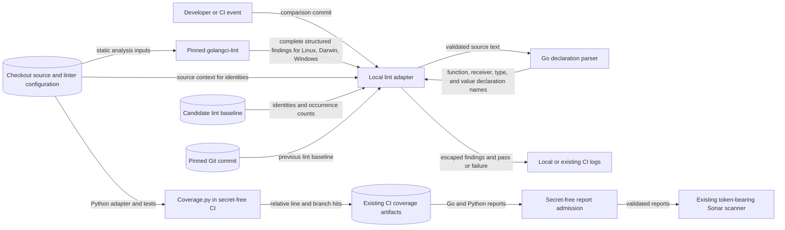

# Strict lint design

The pinned golangci-lint checks Go style and static correctness.
The Python standard library adapter in `scripts/lint.py` checks the lint baseline.
The small Go helper in `tools/lintcontext` identifies enclosing declarations with the standard Go parser.
It uses only standard-library imports and runs as one explicit source file.
Module mode is disabled and GOPATH is an empty temporary directory.
This prevents candidate application and dependency initializers from running during lint.
The Go tool selects the host OS and architecture for this executable.
Static analysis still uses its separate amd64 platform contexts.
[ADR 0005](../adr/0005-static-lint-parser.md) records this exception to application Logger reuse.
`make lint` is the common entry point for developers, hooks, and CI.
The adapter is development tooling. The shipped command does not load it.
The [preflight](lint-preflight.md) records the existing owners and constraints.
The [coding standard](coding-standards.md) records rule coverage and upstream decisions.

## Components and data flow

Source and lint baselines remain in the checkout or its Git history.
Coverage reports use the existing GitHub artifact store and existing Sonar project.
Candidate code runs only in existing CI jobs without secrets.
The Sonar token boundary stays in its separate job.
Sonar classifies the new Python test module as test code, alongside Go tests.
The lint job uses pinned Coverage.py to report Python line and branch coverage.
Only the XML report passes through the existing GitHub coverage-artifact flow.
Admission requires the exact Go and Python reports and rejects linked or unexpected files.
It rejects XML entity and document-type declarations before the token-bearing scanner runs.
There is no runtime deployment or runtime data-flow change.

The configuration uses explicit linters and settings rather than enabling every available linter.
Some available linters impose preferences that conflict with Google style.
Depguard permits only the standard library, fork packages, and exact approved third-party packages.
The approved third-party set contains existing runtime imports and go-cmp.
Unknown assertion or testing libraries therefore fail without relying on their names.
A new external package needs explicit policy review before it can be imported.
The adapter requests complete JSON output with no count limits or per-line collapsing.
It checks Linux, Darwin, and Windows as separate `amd64`, non-cgo contexts.
Tests and development tools are included. No custom build tags are declared.
Fixtures, vendor, and build output are excluded from package analysis.
Generated files use the strict Go marker policy.
The formatter runs separately because golangci-lint v2 separates formatting from analysis.
Formatting differences fail directly. The current tree needs no formatting allowance.

## Baseline contract

An identity contains the checker, relative file, and a SHA256 context fingerprint.
The fingerprint includes the enclosing declaration, diagnostic text, and surrounding nonblank source lines.
The parser identifies functions, receiver-qualified methods, types, and value declarations.
It handles comments, strings, and generic receivers through Go syntax rather than text matching.
It excludes line numbers, absolute paths, and indentation.
Each identity has a positive occurrence count.
Identical diagnostics across build contexts use the maximum count, rather than the sum.
Distinct checker messages and source contexts remain distinct identities.
Context edits can invalidate an allowance. Repair that finding instead of refreshing its identity.
Tool upgrades require explicit policy review.

Let F contain current identities and counts, B contain candidate allowances, and T contain target allowances.
Require F = B and B ≤ T for every identity.
This rejects new findings, stale entries, growth, and equal-count substitutions.
Duplicate JSON keys, repeated identities, invalid fields, and invalid counts are errors.
Analysis errors and type errors cannot enter the baseline.
Normal checks never write a baseline.
An explicit shrink operation may only remove identities or reduce their counts.
It uses the same comparison checks and replaces a regular file atomically.

First adoption permits a nonempty baseline only when the target tree has no lint adapter or lint baseline.
All existing Go source and dependency inputs must remain identical to that pinned target.
Only the new, separately modeled `tools/lintcontext` package may add Go files.
That package must be absent from the target and must have no baseline allowance.
The first baseline must equal the findings under the selected strict settings.
Deleting an established baseline is an error.
This permits checking the initial debt without exporting a second checkout.
The helper executes development-tool code. It parses scanned source without executing it.

PR checks use the event's base SHA. Push checks use the preceding commit SHA.
Manual and local checks resolve `origin/dev`, unless an explicit comparison is supplied.
Comparisons accept a named Git ref or a full commit hash.
Reject options, range syntax, and revision expressions before invoking Git.
Pass ref queries through cat-file stdin, never as command arguments.
An initial branch push uses `origin/dev`. Missing comparison history fails.
Lint and policy jobs fetch history and receive the same comparison.
For the first promotion to `main`, CI supplies `origin/dev` as an explicit adoption base.
This applies only when the target has never had a lint baseline.
The promoted head must contain that integration commit.
Its baseline must already exist and bounds every candidate allowance.
An established target baseline always takes precedence.
The existing `PR Gate` requires lint success.

## Security and failure behavior

| Threat and boundary | Control | Verification |
| --- | --- | --- |
| Hidden debt at JSON boundary | Strict baseline shape, unique keys and identities, positive counts, complete report validation. | Malformed-input and replacement tests. |
| Checkout escape at file boundary | Reject linked policy and source paths, traversal, and external local module replacements. Bound policy and report sizes. | Path and symlink tests. |
| Ambient execution at process boundary | Fixed argument arrays, bounded commands, explicit configuration, no shell or plugin configuration. Clear build overrides and omit credential variables. | Command-failure and environment tests. |
| External processing at analysis boundary | Provision tools separately. Analysis uses cached modules, `GOPROXY=off`, and `GOSUMDB=off`. No source or generator execution. | Actual analysis and command inspection. |
| Missing history or baseline laundering at Git boundary | Resolve a commit, read immutable objects, compare each identity and count, and guard first adoption. | Git integration tests. |
| False success at CI boundary | Fail on incomplete reports, crashes, type errors, formatter differences, and baseline violations. | Failure-injection tests and hosted checks. |
| Misleading output at log boundary | Quote input-derived text. Do not print source excerpts, environment, or raw command output. | Escaped-output tests. |

Maintainer review remains necessary for changes to the checker, configuration, baseline, suppressions, and CI.
These controls do not defend against arbitrary rewrites of their own implementation.
No new service, upload destination, dependency, or runtime interface is introduced.
Existing architecture policy remains separate from lint rule selection.
Its model records the lint adapter, baseline, and version pin as policy owners.

## References and design review

- [Google Go style](https://google.github.io/styleguide/go/), Guide, Decisions, and advisory Best Practices: standard precedence and coverage.
- [golangci-lint v2.15.0 reference](https://raw.githubusercontent.com/golangci/golangci-lint/v2.15.0/.golangci.reference.yml), settings and output: explicit checks, filters, and formatter separation.
- [Revive rule descriptions](https://github.com/revive-lint/revive/blob/master/RULES_DESCRIPTIONS.md), individual rule predicates: supported automatic coverage.
- [Go parser](https://pkg.go.dev/go/parser), Go 1.26.10 `ParseFile`: enclosing declarations without source execution.
- [Coverage.py 7.16.0 configuration](https://coverage.readthedocs.io/en/7.16.0/config.html), branch and relative-file reporting: portable Python coverage.
- [Sonar Python coverage](https://docs.sonarsource.com/sonarqube-cloud/analyzing-source-code/test-coverage/python-test-coverage), report path: import the existing CI coverage artifact.
- [Python 3.12 subprocess](https://docs.python.org/3.12/library/subprocess.html), `run`: fixed arguments, timeouts, and failure handling.
- [Git object inspection](https://git-scm.com/docs/git-cat-file), batch-check: resolve validated stdin queries to commit identities.
- [ASD-STE100](https://www.asd-ste100.org/), writing reference: short sentences and consistent terms. Automated access returned HTTP 403; no formal compliance claim is made.

Existing ADRs 0003 and 0004 cover upstream imports and architecture policy.
ADR 0005 defines the static parser dependency boundary.
No runtime architecture decision changes.
Review the documentation, configuration, baseline, and CI as one change.
