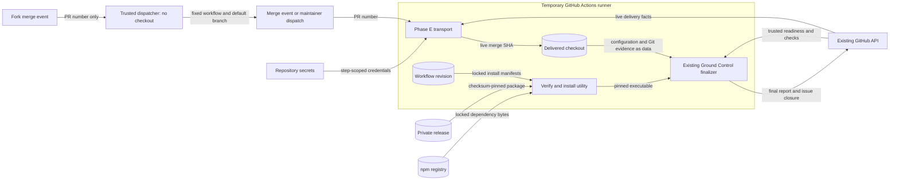

# Automatic delivery finalization design

Issue #97 adds a repository trigger for Ground Control's existing merged-PR finalizer.
The user confirmed ownership of both repositories and directed this integration to proceed.
No additional activation flag or transfer-approval gate is required.

## Components and contracts

| Component | Responsibility |
| --- | --- |
| `.github/workflows/ground-control-phase-e.yml` | Receive a merged-PR event or repair dispatch, resolve the immutable delivery, install the pinned utility, and invoke its finalizer. |
| `.github/ground-control/package.json` and lockfile | Freeze the utility dependency graph and integrity values for `npm ci`. |
| `.github/workflows/ground-control-fork-finalization.yml` | Validate a merged fork PR without checking out source, then dispatch the fixed Phase E workflow on the default branch. |
| Existing Ground Control finalizer | Verify trusted readiness and merge evidence, post one final report, and close the delivered issue idempotently. |
| Existing GitHub API and repository secrets | Supply delivery facts, issue-write access, separate read-only release access, and existing Sonar access. |

The workflow adds no marker parser, completion schema, issue-discovery algorithm, or closure implementation.
Both delivery lanes and repair use the same finalizer.
The Go packages, CLI, Configuration keys/schema, JSON report, and Exit errors remain unchanged.
Existing Logger, Work directory copy, runtime diagrams, and ADRs 0001–0005 need no implementation changes.
ADR 0004 governs the model and design declarations.
The existing static development-check boundary stays unchanged; finalization has a separate network boundary.
No baseline allowance, new service, queue, storage, or hosting is added.

## Release and event choices

The release is Ground Control v1.9.0, asset `grndctl-1.9.0.tgz`.
Its SHA256 is `bec0802871af2d8b816053d842150fce90b1e9e49faaa759726e113d249ea2f6`.
Release metadata and downloaded bytes were checked against that digest.
A temporary install with lifecycle scripts disabled reports CLI version 1.9.0.
The workflow commits the digest rather than downloading a checksum as runtime authority.
Dependencies use a standard npm lockfile, not fresh floating resolution in each job.
Node and external actions are pinned. Private packages are neither committed nor uploaded as artifacts.

Use `pull_request: closed`, filtered to `dev` and `main`, with a merged-state guard.
Use `workflow_dispatch` with one positive decimal PR number for repair.
The release's workflow inspector requires the ordinary PR event.
Its provenance helper accepts `pull_request` and `workflow_dispatch` run-name binding.
The preflight suggestion for `pull_request_target` conflicts with those incumbents and is not used.
The workflow name includes the PR number on both paths, as the provenance helper requires.
Before invoking the CLI, the transport uses the same release's provenance verifier to validate its own Actions run.
A mismatched run is refused before any report or closure.

Both paths read live merge metadata from the current repository and reject unmerged or wrong-base PRs.
Checkout uses the API's immutable merge SHA; dispatch's `GITHUB_SHA` is not delivery evidence.
A separate transport checkout uses the exact workflow revision for installation data.
Repair dispatches must use the default branch.
This separation lets current transport manifests repair an older delivery without executing its files.
Ordinary fork PR events lack the secrets and write token needed by the finalizer.
A separate trusted, merge-only dispatcher invokes the fixed finalization workflow on the default branch for fork deliveries.
It has only PR-read and Actions-write access, checks out no source, reads no private secret, and posts no issue report.
The finalizer therefore still runs through the supported `workflow_dispatch` event with its original permissions.
No Ground Control source, release, or event-trust change is required.
Manual and automatic dispatch require the finalization workflow on the default branch.
The installation PR can still require local reentry because its readiness used the earlier base.

## Data flow

## Security and failure boundaries

| Boundary or threat | Control | Verification |
| --- | --- | --- |
| Untrusted PR input | Validate positive decimal input; pass arguments through quoted variables. Resolve live merged state and permitted base in the current repository. | Execute transport scripts with synthetic invalid, unmerged, and wrong-base cases. |
| Untrusted delivery code | Install outside the checkout. Read manifests from the workflow revision. Execute no delivered action, Go file, hook, generator, or configured command. Keep checkout credentials disabled. | Actionlint and review of executable steps and checkout refs. |
| Release or dependency replacement | Verify committed SHA256 before installation; use `npm ci` with locked integrity values and disabled lifecycle scripts. | Tampered-download rejection and clean locked installation. |
| Credential overreach | Restrict release token to reading Ground Control. Scope it to download only. The finalizer token has evidence reads and `issues: write`, with no content/PR write or merge grant. A separate dispatcher token has only PR-read and Actions-write access. | Permission and step-environment review; actual API access remains a hosted integration check. |
| Credential disclosure | No tokens in argv, URLs, tracing, outputs, Git config, caches, or artifacts. Disable audit submission. Isolate npm configuration/cache from delivery data. | Script review and synthetic credential/setup checks. |
| Settings-file overwrite | Refuse an existing `.env`, create it privately on the ephemeral runner, and remove it on exit. The developer's local `.env` is not copied or changed. | Execute success/failure cleanup and existing-path refusal cases with synthetic settings. |
| False or duplicate closure | Reuse the finalizer's trusted-author, readiness digest, merged-head, hosted-check, and provenance checks. Serialize per PR without cancellation. | Native release workflow/provenance checks; upstream finalizer owns durable idempotency. |
| Partial failure | Preserve nonzero exit status and existing bounded failure records. Never close from a cleanup step. | Failed-finalizer transport check and documented rerun paths. |

The job has a finite timeout. It waits for no unrelated post-merge build, test, release, or scan job.
A no-pointer delivery is the finalizer's successful no-op.
Concurrency limits overlapping runs; it is not a substitute for durable idempotency.
The finalizer reads `.ground-control.yaml` through its own loader and executes none of its workflow commands.
Sonar settings use its existing launch-directory `.env` convention only on the temporary runner.
No new HTTP controller, application auth layer, error hierarchy, or persistent state is introduced.
The release token is not provisioned. GitHub API inspection found the existing Sonar secret and no self-hosted runners.

## Verification and maintenance

The design input declares the affected model, contributor guide, workflow, manifest, and lockfile policies.
`make architecture-design` passed before implementation with ARCH001–ARCH004 and model SHA256
`f50ccf387b1870da4a12fa781ffc2ba38db3dad4ed6d0ced9b70e19f3e1c41f0`.
The completed architecture scan also passes with no baseline findings.
A native release workflow-recognition assertion failed before the workflow existed, then passed for both bases.
Native provenance checks accept both supported events and reject a different PR number.
Use actionlint, targeted transport checks, and a clean locked install for this integration.
CI owns full Go, policy, and mutation runs; Phase E itself runs none of them.
Do not duplicate the external finalizer's behavior or mutation suite here.
The local integration test executes the actual workflow shell steps and installed CLI with a stateful GitHub stand-in.
It substitutes no native finalizer, repository authorization, evidence-discovery, or provenance function.
Sixteen cases passed for both events and branches, report/issue identity, retries, refusal paths, permission denial, untrusted authors, mismatched provenance, immutable revision selection, tampered downloads, locked installation, and fork dispatch.
Finalization runs against a fresh checksum-verified locked installation, not the separately supplied reference executable.
The fixture enforces the workflow permission map and returns installation-token denial for user-identity access.
The matching release source's four targeted suites also passed: 47 tests, no failures or skips.
Actual Actions credential access, API permissions, and report/close behavior need the first configured post-merge run.

The reviewed release/version/asset/digest tuple, manifest, and lockfile form the upgrade seam.
The validated PR number is the repair seam; dispatch cannot select arbitrary code, repository, or completion evidence.
The contributor guide and process-review record link to [setup and recovery](phase-e.md).
Keep those documents and model declarations current when changing the transport or release.

## References

- Ground Control v1.9.0: packaged CLI, workflow inspector, and automation-provenance helper inspected locally.
- Ground Control ADR-102/#1804: consumer workflows are no longer installed by default; this repository adds its own integration.
- [GitHub workflow events](https://docs.github.com/en/actions/reference/workflows-and-actions/events-that-trigger-workflows): PR events, fork restrictions, and dispatch availability.
- [GitHub workflow syntax](https://docs.github.com/en/actions/reference/workflows-and-actions/workflow-syntax): permissions, concurrency, conditions, run names, and inputs.
- [GitHub script injection guidance](https://docs.github.com/en/actions/concepts/security/script-injections): pass data through environment variables.
- [Workflow triggering](https://docs.github.com/en/actions/how-tos/write-workflows/choose-when-workflows-run/trigger-a-workflow): `workflow_dispatch` can be triggered by `GITHUB_TOKEN`.
- [npm clean installation](https://docs.npmjs.com/cli/v11/commands/npm-ci/) and [lockfile integrity](https://docs.npmjs.com/cli/v11/configuring-npm/package-lock-json/): fixed dependency graph with integrity verification.

Verification evidence: [TAP results](evidence/phase-e-v1.9.0.tap) and [release/source/file hashes](evidence/phase-e-v1.9.0.json).
