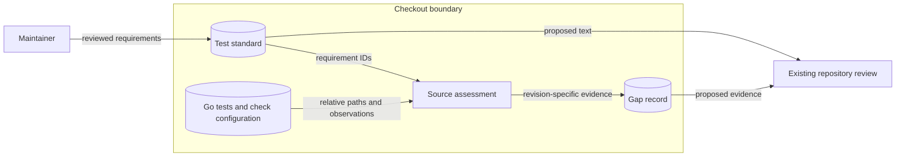

# Test standard architecture preflight — issue #78

Issue #78 requires one documented standard for Go package tests and a record of current gaps.
This note bounds that work. It does not define the standard, supply the gap record, or plan implementation.
Existing ADRs cover the design; no new architecture decision or runtime layer is needed.

## Authority and scope

Keep the standard and its assessment as separate development documents under `docs/development/`.
The standard should extend the test guidance in the [Go coding standard](coding-standards.md), which already
adopts Google's Guide and Decisions and distinguishes advisory Best Practices. Resolve overlapping guidance
in [CLAUDE.md](../../CLAUDE.md) and [Contributing](../CONTRIBUTING.md) through links to the standard rather
than maintaining competing rule lists. Do not copy linter settings, dependency lists, or thresholds into it.
State which requirements need human review and which existing checks enforce a limited predicate.

The assessment scope is every Go package in `cmd/`, `internal/` (including subpackages), and `tools/`.
Use the package ownership inventory in [the architecture model](../../.architecture/model.json) and verify
it against checkout files. Include packages without adjacent tests, same-package and external tests,
helpers, subprocess entry points, and platform/build-tag variants. A package can be exercised elsewhere;
absence of a local `_test.go` is evidence to investigate, not proof of missing behavioral coverage.
Do not treat byte-exact `testdata` files or their nested example modules as application packages.
Python tooling tests retain their existing checks but are outside the Go test standard's assessment scope.

Use stable requirement anchors in the standard as the extension seam. The record can reference those anchors,
package/file/test names, the inspected revision, evidence, and applicability without duplicating rule text.
Account for the full package scope and explain exclusions; mark unverified claims explicitly.
Each reported gap needs a concrete observation tied to a requirement. A few examples cannot establish
repository-wide compliance. The record is a dated assessment, not a suppression baseline or an automatic gate.
Do not invent a JSON schema, scoring engine, debt ratchet, or generated inventory for a prose deliverable.

## Canonical owners to reuse

| Concern | Existing owner and boundary |
| --- | --- |
| Test structure and assertions | Standard `testing`, table-driven tests where useful, and the existing `go-cmp` dependency. The coding standard permits both package visibility choices and does not force parallelism. `.golangci.yml` owns approved imports, helper checks, testing APIs, and error checks; do not introduce assertion frameworks or shared test infrastructure. |
| Test doubles | `internal/engine/executor.go` has `WithExecContext`; coverage and diff have `NewWithCmd`; engine tests have local dealers and stubs. Build on existing seams when describing behavior checks. Do not require a new interface for every dependency or mock private call sequences instead of outcomes. |
| State and isolation | `internal/configuration` owns Configuration keys and synchronized Viper access; `internal/log` owns the singleton Logger; `internal/engine/workdir` owns the Work directory copy. Standard testing cleanup, temporary directories, environment and working-directory controls complement these owners. Locks do not make a sequence of configuration changes isolated between tests. |
| Errors and outputs | Ordinary Go errors with wrapping and `errors.Is`/`As`; `internal/execution` owns Exit errors. `internal/report/internal/structure.go` owns the mutation JSON shape. Use those contracts in assessment; the gap record is not a mutation report or a new error hierarchy. |
| Local and hosted checks | `Makefile`, `.ground-control.yaml`, `.pre-commit-config.yaml`, and `scripts/install-hooks.sh` own invocation. Contributing prescribes targeted local race tests and full hosted checks. Do not add another runner or change hook dispatch to document a standard. |
| Static policy | `.golangci.yml`, `mise.toml`, `scripts/lint.py`, `.lint/baseline.json`, and `tools/lintcontext` own lint and its shrink-only debt. `.architecture/model.json`, its baseline, `tools/architecture`, and `scripts/check-design.sh` own package/design checks. Passing either does not establish test semantics. |
| Measurements | `make cover` and `.github/workflows/ci.yml` own race/atomic coverage on Linux, macOS, and Windows. `.github/workflows/gremlins.yml` and `.gremlins.yaml` own candidate-source mutation testing and existing thresholds. `sonar-project.properties`, `.coveragerc`, and `scripts/check-coverage.sh` own coverage ingestion, including Python coverage. Link to these owners. |

## Security and cross-cutting boundaries

The intended artifacts are reviewed Markdown stored in Git. Their data flow is checkout inspection →
standard and assessment documents → existing repository review. They add no runtime input, parser,
authentication surface, persistence service, or deployment. Existing runtime and CI flows are described in
[CLAUDE.md](../../CLAUDE.md) and [the architecture documentation](architecture.md).

| Layer the work encounters | Required treatment |
| --- | --- |
| Filesystem, privacy, and process exposure | Keep inspection inside this checkout and records to relative paths and synthetic examples. Do not read secret files or include credentials, host configuration contents, raw environment dumps, or sensitive subprocess output. No new uploads, services, or credentials in argv. Static inspection is sufficient for documentation claims; test execution is separate evidence and may execute candidate code. |
| Configuration and environment shapes | `configuration.Init` searches host locations and enables `GREMLINS_*` overrides. Review isolation of these effects, Viper and Logger resets, cwd, and inherited child environments. Reuse Configuration keys and dot/hyphen-to-underscore binding semantics; do not add a second validator. The existing configuration JSON schema is editor guidance, not evidence of runtime validation. The assessment itself must not initialize runtime configuration. |
| Architecture input validation | `.architecture/design.json` uses the existing strict decoder/compiler (version, duplicate/unknown fields, references, contracts, trust assertions and checkout paths). Declare actual affected packages/policies if scope changes, including updates to canonical guidance. No model widening or baseline growth is needed. ADR 0004 applies. |
| Lint execution boundary | Retain the isolated standard-library-only parser under ADR 0005. Requiring application Logger imports for every test tool would break that boundary. Application output still uses Logger; test failure reporting uses `testing.T`. Preserve security lint, justified suppressions, approved imports, and shrink-only findings. |
| CI authorization and admission | Existing jobs use pinned actions, read-only permissions and checkout without persisted credentials. Candidate execution stays outside the token-bearing Sonar job. Preserve foreign-PR handling, exact Go/Python report admission, regular-file/symlink checks, XML declaration rejection, and Sonar property allowlisting/path checks. Documentation needs no new CI artifact or authorization flow. |
| Error and diagnostic boundary | Refer to existing Go errors, Exit errors, Logger, and test failure messages. Record errors without leaking inputs. There is no HTTP error envelope, controller/DTO stack, or application auth gate to extend. A skipped or unrun check is not a passing result. |

## Assessment gotchas

The assessment must distinguish intended behavior from current habits; existing tests are examples, not
automatic authority. These inspected locations illustrate risks to evaluate, not the completed gap record:

- `internal/configuration/configuration_test.go` changes cwd and initializes Viper; engine test stubs
  serialize configuration while report/log tests redirect the singleton Logger. Review restoration on early
  failure, environment dependence, and order independence. Do not mandate `t.Parallel` around process globals.
- Coverage and executor tests re-enter the test binary with `GO_TEST_PROCESS`. Identify helper entry points
  separately from assertions. Preserve narrowly selected child tests, explicit child environment, bounded
  waits, cancellation and cleanup. Check Unix process groups and Windows behavior separately; temporary
  copies isolate files but do not sandbox processes, network access, or credentials.
- Worker-pool tests coordinate through channels. Assess bounded failure, goroutine termination and cleanup;
  sleep-based success or assertions in an unobserved goroutine are weak evidence. Prefer existing channels
  and contexts over introducing a generic clock or concurrency framework.
- `internal/report/report_test.go` reads and decodes a golden JSON fixture with ignored setup errors;
  `internal/engine/stubs_test.go` also ignores fixture I/O errors. Check whether failures can produce a false
  pass or misleading diagnostic. Preserve fixture bytes and canonical report semantics. Permission tests
  need explicit account of Windows ACLs and privileged hosts, not an assumed POSIX-only failure.
- `tools/architecture` already tests malformed data, forbidden imports, Git history, links, and diagnostic
  leakage. `tools/lintcontext` tests parsing and writer failures. Include these security and negative cases;
  avoid a second test-policy validator that replicates their logic.
- Test assertions need independent expected outcomes, relevant boundaries and failure paths, useful
  got/want diagnostics, and semantic error checks. Table shape, test names, coverage percentages or an
  assertion's mere presence cannot prove those properties. Focus on observable contracts; avoid blanket
  requirements for fuzz tests, benchmarks, white-box tests or black-box tests regardless of purpose.
- Statement coverage, mutation efficacy, mutant coverage, and regression proof answer different questions.
  Do not infer fresh results from configuration or undated output. `make cover` is a file target and can
  reuse an existing `coverage.out`; provenance matters. Hosted coverage uploads the Linux Go profile even
  though all three OS jobs run. The separate Gremlins workflow is not a dependency of `PR Gate`.
- The product's `--integration` mode changes mutant execution scope; it is not a repository test category.
  `make test` enables `-race`, but nested mutant commands in `executor.go` and baseline coverage commands
  in `coverage.go` do not automatically inherit it. Record the distinction without changing runtime flags
  or promoting documentation into a new execution policy.

## Non-goals and binding boundaries

No test repairs, mass renaming/reformatting, new dependencies, checker, schema, workflow, threshold,
baseline allowance, or CI gate is required by #78. Changed-line mutation gates and regression enforcement
belong to #79. Broad remediation belongs to later work; a gap record must remain candid about debt.
Do not run full suites locally merely to write documentation or claim mutation execution for this preflight.
Use existing targeted checks when execution materially supports the later assessment.

Preserve downstream CLI flags, Configuration keys and JSON schema, mutation JSON report, and Exit errors
used by autarchy-ai/coldlight and OpenRAE/env-packs. Preserve byte-exact `testdata` inputs.
No upstream import is needed; any later import remains governed by ADR 0003.
ADRs 0004 and 0005 bind architecture and static-analysis boundaries. This guidance proposes no change to
module identity or binary/release policy under ADRs 0001–0002.

## Preflight evidence

Inspected revision: `67008e1c54c758f0bd300ea26a21e3a0f4e2cde8`.
`make architecture-design` passed for design #78 with rules ARCH001–ARCH004 and model SHA256
`0ce3c20d3463ec405e5889d5a208f21208c9f26f1d74f5c3f9dc55e9478a52a4`.
No package/import or runtime-contract changes are proposed; the trust assertion keeps existing boundaries.
The executable check validates those declarations, not the completeness or quality of a future assessment.
No test or mutation results were produced in this preflight.

## Delivery design

[The test standard](test-standard.md) owns test requirements T01–T10.
[The assessment](test-assessment.md) records observations against those requirements at the inspected revision.
Contributor guidance links to this authority instead of repeating test rules.
The coding standard continues to own Go style and lint policy.
The assessment records test debt; it does not grant exceptions or change tests.
Each gap has a requirement, source location, observed weakness, and verification needed for closure.
Every modeled Go package has an inventory row, including packages tested elsewhere.
Source review cannot establish measured coverage, race freedom, or mutation effectiveness.
These results remain unverified unless a named run supplies evidence.

The diagram describes document data flow, not runtime execution.
The existing runtime component diagram and deployment remain valid because no runtime files change.
The architecture model has no new package, import, contract, or trust boundary.
The design input declares the two affected guidance policies.
ADRs 0004 and 0005 remain sufficient; no new ADR is needed.
Existing policy checks retain their commands, baselines, and permissions.

| Threat and boundary | Control and verification |
| --- | --- |
| Private data enters the record at inspection | Use repository-relative source references. Review the diff for host data, secrets, and raw process output. |
| A source observation becomes an unsupported success claim | Name the revision and inspection method. Mark unmeasured results explicitly. Check every claim against its source. |
| Documentation implies new execution or access authority | Preserve existing commands and CI boundaries. Compare the final diff with the design declarations. |
| Future edits split the standard | Use stable IDs and links. Check contributor guidance and assessment references together. |

Residual risk: source review can miss behavior gaps, and a dated record becomes stale after code changes.
Refresh affected evidence when repairing tests. Use hosted execution evidence to assess runtime properties.

References reviewed on 2026-11-03:

- [Go testing source](https://github.com/golang/go/blob/go1.26.10/src/testing/testing.go), Go 1.26.10: package documentation, `Cleanup`, `TempDir`, `Setenv`, `Chdir`, and `Parallel`.
- [Go race detector](https://go.dev/doc/articles/race_detector), Usage and Typical Data Races: race checks and their execution limits.
- [Google Go Decisions](https://google.github.io/styleguide/go/decisions), Tests: assertions, diagnostics, helpers, and table structure. The coding standard records the adopted snapshot.
- [Google Go Best Practices](https://google.github.io/styleguide/go/best-practices), Testing: advisory guidance for behavior and test doubles.
- [ASD-STE100](https://www.asd-ste100.org/), writing reference: the official site denied automated access. Prose was reviewed for brevity and consistent terms; formal compliance is unverified.
